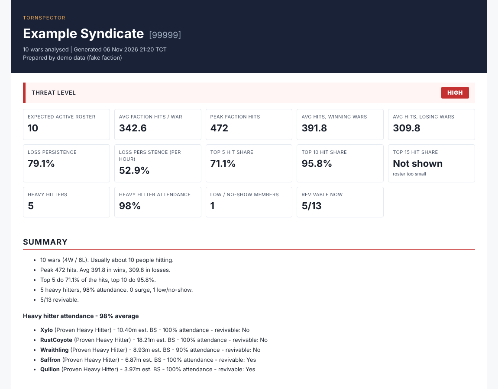

# tornspector


Ranked war intel on enemy factions in Torn. Someone was selling these for 5 xanax each so I made my own lol.



[example report](docs/sample-report.html)

## setup

Python 3.10+, nothing to install.

```
git clone https://github.com/sqlinjected/tornspector.git
cd tornspector
copy .env.example .env
```

Put your Torn API key in `.env` (public key works). Battle stats need your key registered on ffscouter.com, otherwise that column is just empty.

## usage

```
python -m tornspector report 12345
python -m tornspector report 12345 --wars 20
python -m tornspector demo
```

Report ends up in `reports/`. Ctrl+P to save it as a pdf.

For the activity pages run `python -m tornspector watch 12345` and leave it on for a week or so. It checks their roster every 15 min.

## notes

- only counts wars a member was actually in the faction for, so new people aren't no-shows
- loss persistence = avg hits in losses / avg hits in wins
- threat score weights are in `THREAT_WEIGHTS` in analysis.py if you want to mess with them
- finished wars get cached so reruns are fast

## API ToS

| | |
|---|---|
| Data storage | Only on your own PC (`cache/`, `data/`, `reports/`) |
| Data sharing | None |
| Purpose of use | Faction war planning |
| Key storage & sharing | Only in your `.env`, not logged or shared |
| Key access level | Public |

MIT
